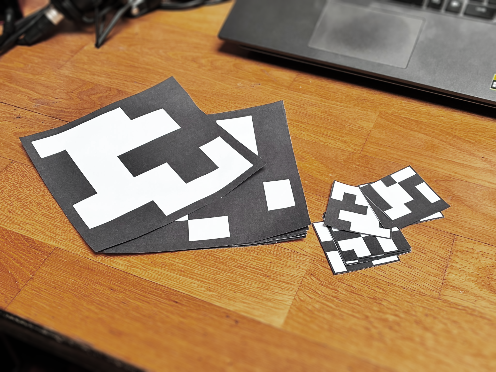
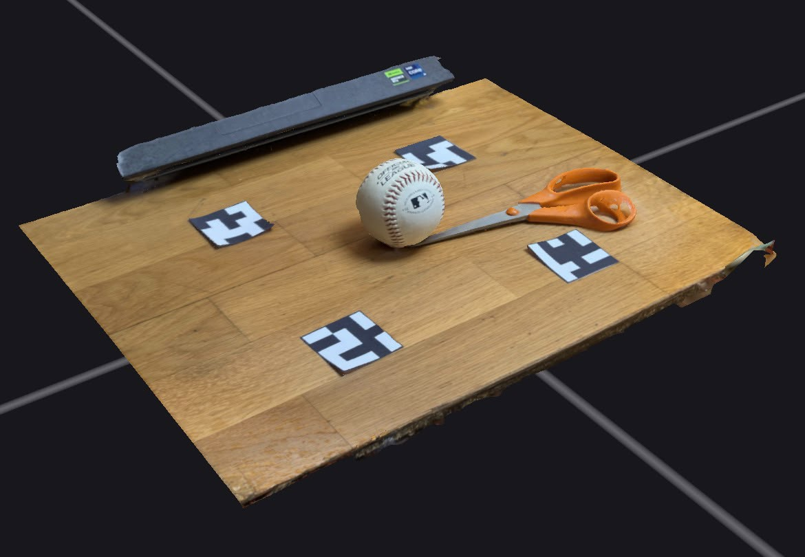
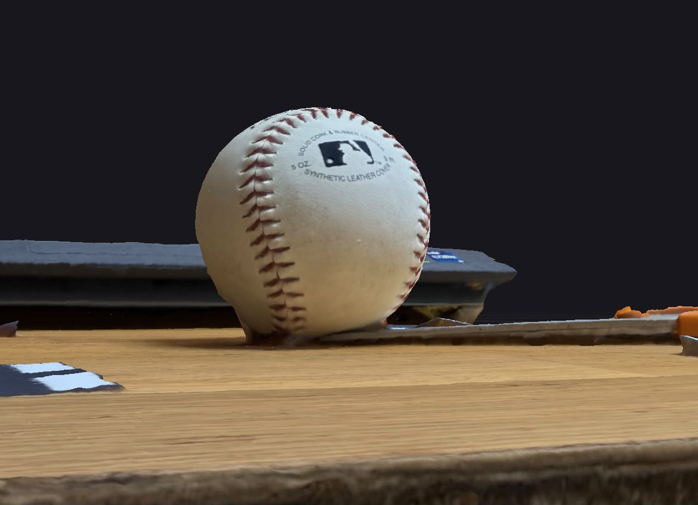

<picture><source media="(prefers-color-scheme: dark)" srcset="https://www.shieldcn.dev/github/stars/LouisGJBertrand/qr_mark.svg?variant=secondary&amp;size=sm&amp;mode=dark"></picture>
<picture><source media="(prefers-color-scheme: dark)" srcset="https://www.shieldcn.dev/github/last-commit/LouisGJBertrand/qr_mark.svg?variant=secondary&amp;size=sm&amp;mode=dark"></picture>
<picture><source media="(prefers-color-scheme: dark)" srcset="https://www.shieldcn.dev/github/open-issues/LouisGJBertrand/qr_mark.svg?variant=secondary&amp;size=sm&amp;mode=dark"></picture>
<picture><source media="(prefers-color-scheme: dark)" srcset="https://www.shieldcn.dev/github/ci/LouisGJBertrand/qr_mark.svg?variant=secondary&amp;size=sm&amp;mode=dark"></picture>

# QR Mark

A simple CLI tool to generate customized random markings useful for 3D scans of interior environments.

## Requirements
production:
```
Pillow==13.0.0
```

dev:
```
Pillow==13.0.0
flake8
pytest
```

## Installation
```bash
git clone https://github.com/LouisGJBertrand/qr_mark.git
cd qr_mark

# /!\ It's recommended to activate venv
python -m venv venv
venv\Scripts\activate

pip install -r requirements.txt
```

## Usage

```bash
# default settings:
# - formatted output in "./out/mark_%03d.png"
# - size is 25 (5x5px)
# - count is 8

# available params:
# -o <string> formatted output path
# -c <int> output count
# -s <int> size interpreted as square by default
# -x <int> size X override
# -y <int> size Y override
# note: if one of the two size override arguments is not defined, it will be calculated based on total size divided by the other size override argument.
# example: -s 50 -x 10, y will be 5
# if x and y are present, s is omitted.

# generate with default settings, 8 markings with total pixel count of 25, square size of 5x5
py ./main.py
# equivalent to
py ./main.py -c 8 -o "./out/mark_%03d.png" -s 25

# generates a marking in "./out" formatted with 5 leading zeros as pngs with total pixel count of 64, square of 8x8
py ./main.py -c 1 -o "./out/%05d.png" -s 64

# generates 4 markings of size 16x32px
py ./main.py -c 4 -x 16 -y 32
```

it's possible to use the tool as a dependency

to install, copy the `qr_mark` folder at your project root. pip is not yet available to install this module.

to use the modules, you can import them as follows
```python
# the marking generator
# used to generate pixels array
# calculate expected size etc.
from qr_mark.qr_gen import QrGen

# the marking settings class
from qr_mark.qr_settings import QrSettings

# the pipeline for batch generation, saving etc.
from qr_mark.qr_pipeline import QrPipeline

# the cli entrypoint
from qr_mark.qr_cli import QrCLI
```

the pipeline could be used as follows
```python
# create the settings object (refer to qr_mark/qr_settings.py for constructor)
settings = QrSettings(count=8, output="./tests/data/batch/%03d.png")
# initialize the pipeline object for image generation and export
pipeline = QrPipeline(settings)

# generate the images based on the settings
images = pipeline.generate_images()
# save the images following the output path
pipeline.save_images(images)
```

## Demonstration


> these markings have been generated with default settings
> and modified in photoshop to be prepared for printing.
> 
> An outline has been added and printed in two different formats.
> 
> Big markings can be used to scan 3D interior.
> Small markings to scan small objects.




> demonstration 1:
> 
> scanning of a baseball. The white surface makes it difficult to match features across photos.
> 
> instead of sticking scanning markings directly on the model, use the qr markings to match from afar.

 

## Use of AI
No AI is used to generate code.

in this repo, Ai is used only for code quality (Mistral) along side flake8 and documentation correction (Gemini).

## Licensing
GPL 3.0
